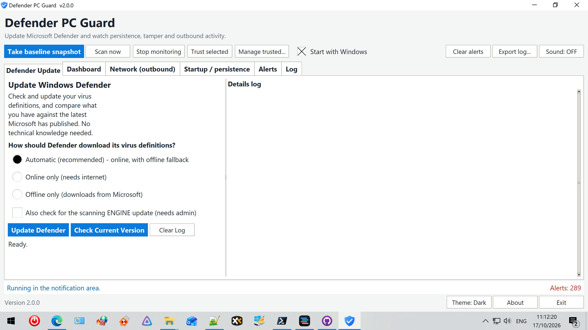
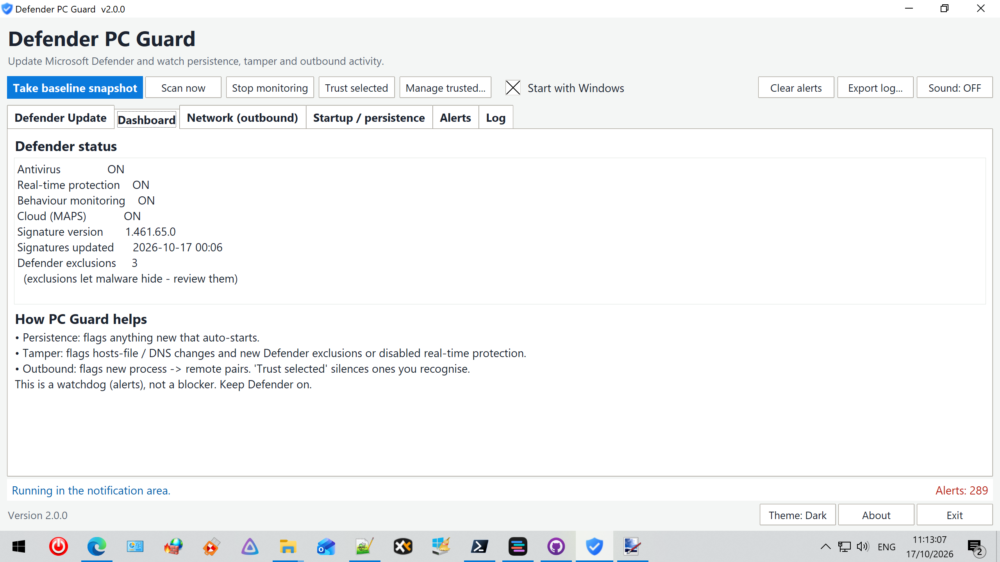
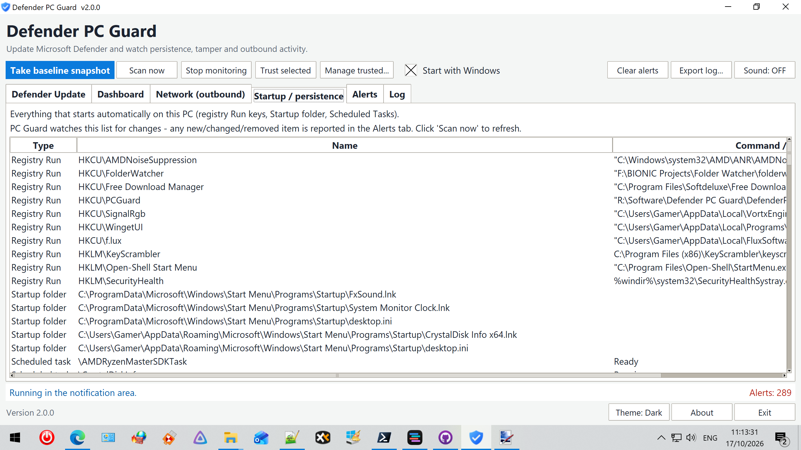
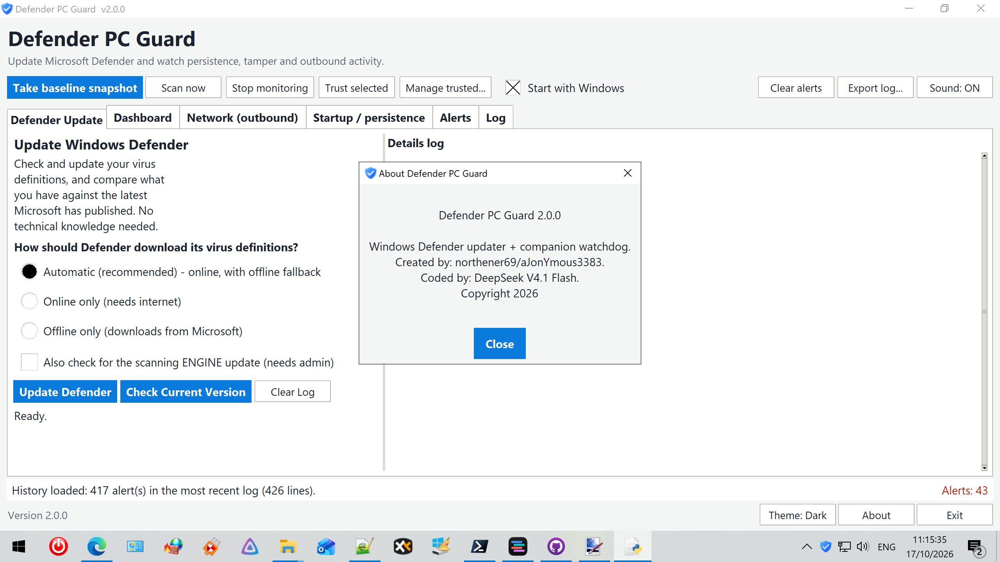

# Defender PC Guard

A merged application that combines **Windows Defender Updater** and
**PC Guard** into one themed Windows 10/11 GUI.

- **Update** Microsoft Defender (definitions + optional scanning engine).
- **Check** your installed versions against the latest Microsoft has published.
- **Watch** persistence, tamper and outbound activity as a Defence companion.
- **Light & Dark themes**, toggleable from the footer.

---

## Screenshots

---

## What's inside

### Defender Update (new tab, left of the Dashboard)
From the original *Windows Defender Updater* app:

- **Update Defender** — updates your virus definitions (Automatic / Online /
  Offline) and, optionally, the scanning engine.
- **Check Current Version** — shows what's *installed* on this PC and compares
  it against the **latest Microsoft has published online**, so "up to date"
  has a clear meaning.
- A colour-coded live **log window** plus a plain-English summary pop-up.

Quick **Update Defender** and **Check Version** buttons also live in the
footer, right where the version number is shown, so you can reach them from
any tab.

### PC Guard (watchdog)
PC Guard is **not** an antivirus — Defender is already good at that. It watches
the things Defender is weakest on, as a **watchdog that alerts you**:

1. **Persistence** — what auto-starts (Run keys, Startup folder, Services,
   Scheduled Tasks). Alerts on any new / changed / removed entry.
2. **Tamper** — the **hosts file** (hash), your **DNS servers**, and **Defender's
   own settings** (exclusions added, real-time protection disabled).
3. **Outbound** — which processes talk to the network, flagging any **new
   process → remote-address** pair you haven't trusted.

## Tabs

- **Defender Update** — update & check Defender (new, leftmost).
- **Dashboard** — live Defender status and what PC Guard does.
- **Network (outbound)** — live connections per process (plus any seen in the
  last 5 minutes). New = red, trusted = green, not-answering = amber, closed = grey.
- **Startup / persistence** — everything that auto-starts.
- **Alerts** — every alert, newest at the bottom.
- **Log** — timestamped history, with the previous run loaded at startup.

## Dark theme

Click **Theme: Dark / Theme: Light** in the footer (next to About) to switch
between the two palettes. The whole UI — tabs, lists, log areas and status bar —
re-themes instantly.

## How to use it

1. Run it and let it sit a moment while it reads your system.
2. Click **Take baseline snapshot** when you're confident the PC is clean.
3. Click **Scan now** any time. Real changes appear in **Alerts** + the counter.
4. Use the **Defender Update** tab (or the footer buttons) to update/check
   Defender whenever you like.
5. If a flagged outbound connection is something you use, select it in the
   **Network** tab and click **Trust selected**.

## Requirements (to run from source)

- **Python 3.9 or newer** — download from [python.org](https://www.python.org/downloads/).
  If you use the Windows installer, **tick "Add python.exe to PATH"** so the `python`
  command works in a terminal.
- **tkinter** — this comes bundled with the standard Windows Python installer (the
  "tcl/tk" part), so there's **no separate step** needed.
- **pystray** and **Pillow** — only needed for the tray / minimise-to-tray icon.
  The app runs fine without them, it just won't minimise to the notification area.

Install the optional extras (run this in a terminal):

    pip install -r requirements.txt

or, if you'd rather type it directly:

    pip install pystray Pillow

## Run it

- **From source:** `Run Defender PC Guard.bat`, or `python DefenderPCGuard.pyw`
- **Build an exe:** `pip install pyinstaller` then `pyinstaller DefenderPCGuard.spec`
  → `dist\DefenderPCGuard.exe`

## Notes

- Keep **Microsoft Defender switched on** — this app complements it, not replaces it.
- The **engine** update needs Administrator rights.
- Data (baseline, trusted list, ignored alerts, daily logs) is stored in
  `%LOCALAPPDATA%\PCGuard`.
- **Minimise or close** the window to keep it running in the notification area.

## Contact

Questions or feedback? Get in touch at **northener69@duck.com** (a relay address — it reaches me without exposing my main inbox).
